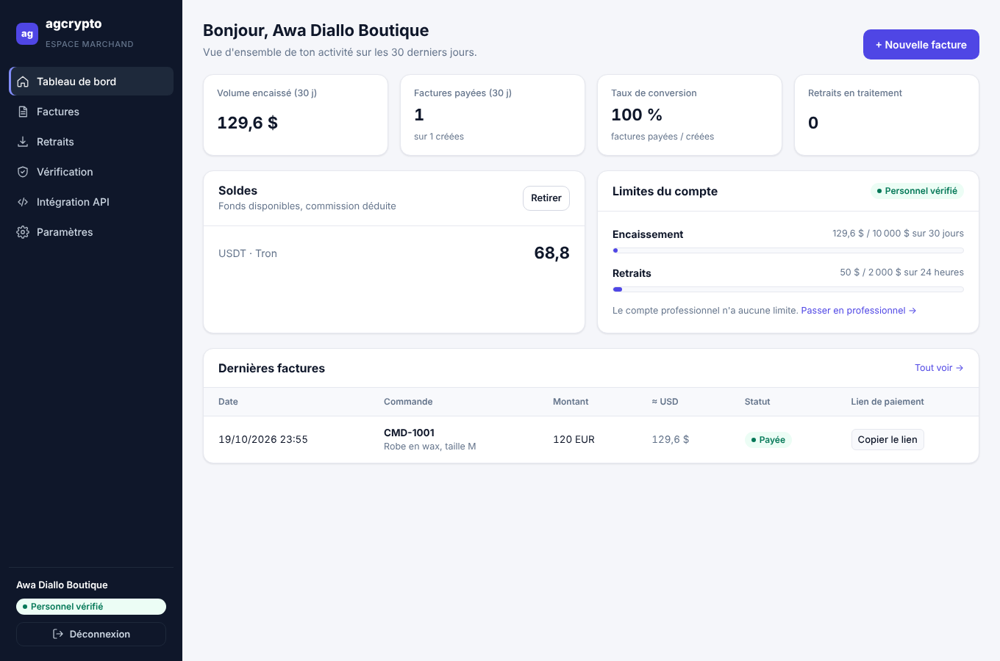
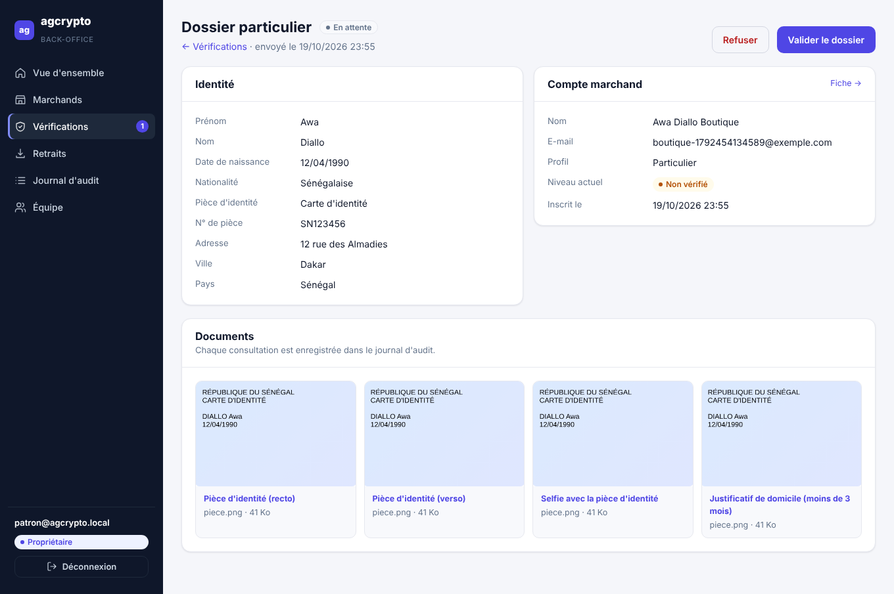

# agcrypto

Passerelle de paiement crypto multi-marchands, sur le modèle de NOWPayments et Cryptomus.
Les paiements sont encaissés via NOWPayments sur le compte de la plateforme. Chaque marchand a un
solde interne et demande des retraits, contrôlés puis envoyés par l'équipe.

| Tableau de bord marchand | Revue d'un dossier (back-office) |
|---|---|
|  |  |

## Architecture

```
agcrypto/
├── backend/             API (Fastify + PostgreSQL + Drizzle) : toute la logique et l'argent
│   ├── src/modules/
│   │   ├── auth/            comptes, e-mail, sessions, mots de passe
│   │   ├── merchant/        tableau de bord, clés API, webhook, infos publiques
│   │   ├── kyc/             vérification d'identité (particulier) et d'entreprise
│   │   ├── limits/          limites par niveau de vérification
│   │   ├── payments/        factures, page de paiement, notifications NOWPayments
│   │   ├── ledger/          registre comptable (soldes, revenus)
│   │   ├── withdrawals/     retraits et frais
│   │   ├── admin/           back-office : rôles, marchands, équipe, journal d'audit
│   │   ├── notifications/   e-mails transactionnels
│   │   └── webhooks/        notifications signées vers le site des marchands
│   ├── drizzle/         migrations SQL
│   └── test/            tests sur un vrai PostgreSQL en mémoire
├── frontend/            React + Vite : espace marchand et back-office (affichage uniquement)
└── docker-compose.yml   PostgreSQL + Mailpit (boîte e-mail de test) pour le développement
```

Le frontend n'a aucune logique métier : il affiche et appelle l'API. **Une seule API, le backend.**
En développement, Vite relaie `/api/*` vers le backend (même origine : cookies de session, pas de CORS).

## Lancer en local

Prérequis : **Node.js 22+** et **Docker**.

```bash
npm install                                  # installe backend + frontend
npm run setup                                # crée backend/.env (rien à remplir pour tester)
npm run db                                   # PostgreSQL + Mailpit, puis création des tables
npm run admin:create -- ton@email.com        # ton compte back-office (mot de passe affiché une fois)
npm run dev                                  # backend + frontend
```

| Adresse | Contenu |
|---|---|
| http://localhost:3001 | Espace marchand : inscription, tableau de bord |
| http://localhost:3001/admin | Back-office de l'équipe |
| http://localhost:3000/docs | Documentation interactive de l'API (Swagger) |
| http://localhost:8025 | Boîte de réception de test : codes de vérification, e-mails envoyés |

Tous ces services n'écoutent que sur `127.0.0.1` : ils ne sont pas accessibles depuis le réseau.

**Mode démo** (par défaut, `NOWPAYMENTS_ENV=demo`) : adresses de paiement fictives et bouton
« Simuler le paiement » sur la page de paiement, pour tester tout le parcours sans compte NOWPayments.

## Parcours

1. **Inscription** : profil *Particulier* ou *Entreprise*, e-mail et mot de passe.
2. **Vérification de l'e-mail** : code à 6 chiffres (valable 30 min, 5 essais).
3. **Intégration** : le marchand crée ses clés API et configure son webhook.
4. **Encaissement** : facture → lien vers la page de paiement → le client choisit sa crypto → NOWPayments.
   Le solde est crédité (moins la commission) dès la confirmation, et le site du marchand est notifié.
5. **Vérification d'identité** : KYC (particulier) ou KYB (entreprise) avec documents, revue par l'équipe.
6. **Retraits** : réservés aux comptes vérifiés, montant bloqué à la demande, envoyé par l'équipe finance.

## Niveaux de compte et limites

Montants en équivalent USD, modifiables dans `backend/.env`.

| Niveau | Encaissement | Retraits | Vérification |
|---|---|---|---|
| Non vérifié | 1 000 $ au total | ❌ | — |
| Particulier vérifié | 10 000 $ / 30 jours | 2 000 $ / 24 h | Pièce d'identité, selfie, justificatif de domicile |
| Entreprise vérifiée | Illimité | Illimité | Documents de l'entreprise + identité du dirigeant |

Un particulier vérifié peut passer en entreprise en envoyant un dossier KYB.
Les factures en attente comptent dans la limite ; les cryptos sont évaluées au cours (via NOWPayments).

## Équipe back-office

| Rôle | Peut |
|---|---|
| Propriétaire | Tout, y compris gérer l'équipe et lire le journal d'audit |
| Conformité | Examiner les dossiers KYC/KYB, suspendre des marchands |
| Finance | Traiter les retraits, voir les revenus |
| Support | Consulter les marchands et les retraits (lecture seule) |

Toutes les actions (validation de dossier, consultation d'un document d'identité, envoi d'un retrait,
suspension, gestion de l'équipe) sont enregistrées dans le **journal d'audit**.

## Frais (revenus de la plateforme)

| Variable | Défaut | Effet |
|---|---|---|
| `PAYMENT_FEE_PERCENT` | `1` | % retenu sur chaque paiement reçu (les frais NOWPayments sont déjà déduits par eux) |
| `WITHDRAWAL_FEE_PERCENT` | `10` | % retenu sur chaque retrait |
| `WITHDRAWAL_FIXED_FEES` | `{"usdttrc20":"1",...}` | Frais fixe par crypto ajouté au retrait (frais réseau) |

## Passer sur NOWPayments

Dans `backend/.env` :

```
NOWPAYMENTS_ENV=sandbox            # puis production
NOWPAYMENTS_API_KEY=...            # dashboard NOWPayments
NOWPAYMENTS_IPN_SECRET=...
PUBLIC_BASE_URL=https://...        # adresse publique de l'API (NOWPayments y envoie ses notifications)
```

En local, exposer l'API avec `cloudflared tunnel --url http://localhost:3000` et mettre l'adresse obtenue
dans `PUBLIC_BASE_URL`.

## API

Documentation complète et testable : **http://localhost:3000/docs**.

- **Site du marchand** : `Authorization: Bearer agc_...` (clé créée dans le tableau de bord).
  `POST /v1/invoices`, `GET /v1/invoices`, `GET /v1/balance`, `GET /v1/limits`, `POST /v1/withdrawals`…
- **Webhooks** : en-tête `x-agcrypto-signature: t=<timestamp>,v1=<hmac>`,
  avec `hmac = HMAC-SHA256(secret, "<timestamp>.<corps brut>")`. Rejeter un timestamp de plus de 5 minutes.

## Sécurité

- Mots de passe hachés (scrypt), sessions dans des cookies `HttpOnly` / `SameSite=Lax`, en-tête anti-CSRF.
- Limitation des tentatives (connexion, inscription, codes, mot de passe oublié).
- Clés API et jetons stockés uniquement sous forme d'empreinte (SHA-256).
- Documents d'identité : type réel vérifié (signature du fichier), stockage privé, accès tracé.
- Registre comptable : un paiement ne peut pas être crédité deux fois, montants en décimal exact.
- Notifications NOWPayments vérifiées (HMAC-SHA512), statuts qui ne reculent jamais.
- Retraits : verrou par marchand (pas de double dépense), frais figés à la demande.

## Tests

```bash
npm test          # 32 tests backend sur PostgreSQL en mémoire (PGlite)
npm run typecheck # backend + frontend
```

## Avant la mise en production

- [ ] HTTPS obligatoire (cookies `Secure` activés automatiquement quand `PUBLIC_BASE_URL` est en https)
- [ ] Reverse proxy (Nginx, Caddy) : frontend compilé (`npm run build`) + `/api` → backend
- [ ] SMTP réel (`SMTP_URL`) : Brevo, Mailgun, ou le serveur de ton hébergeur
- [ ] PostgreSQL et `UPLOAD_DIR` (documents d'identité) sur disque persistant, **avec sauvegardes chiffrées**
- [ ] Mettre à jour régulièrement `FX_RATES_USD` (taux des devises de facturation)
- [ ] Double authentification (2FA) pour l'équipe et les retraits : recommandée avant d'ouvrir au public
- [ ] Plusieurs serveurs API : déplacer la limitation des tentatives dans Redis (aujourd'hui en mémoire)
