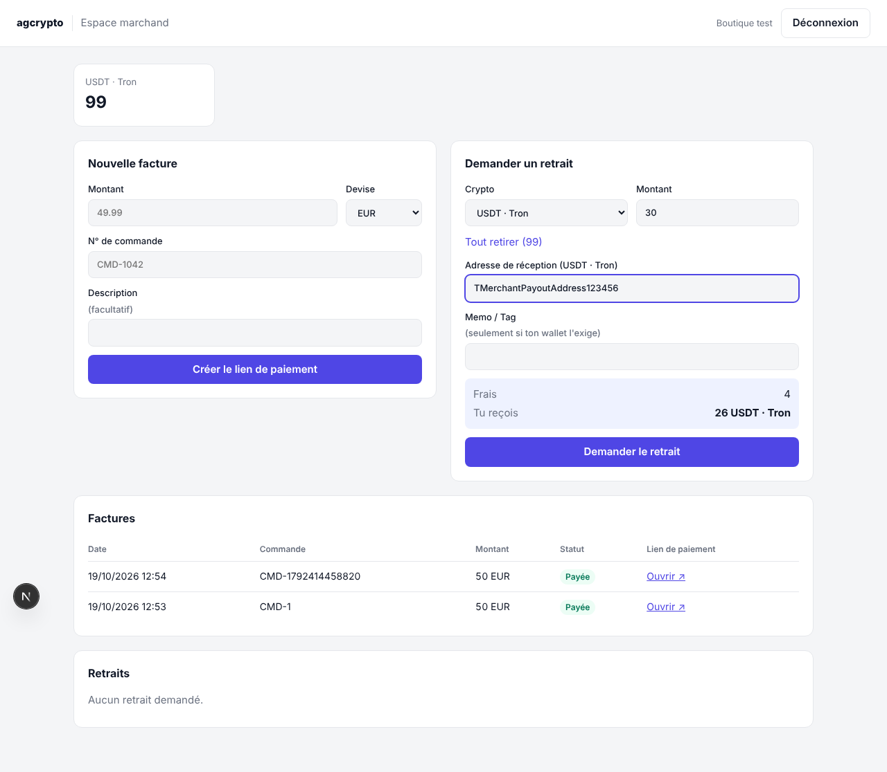
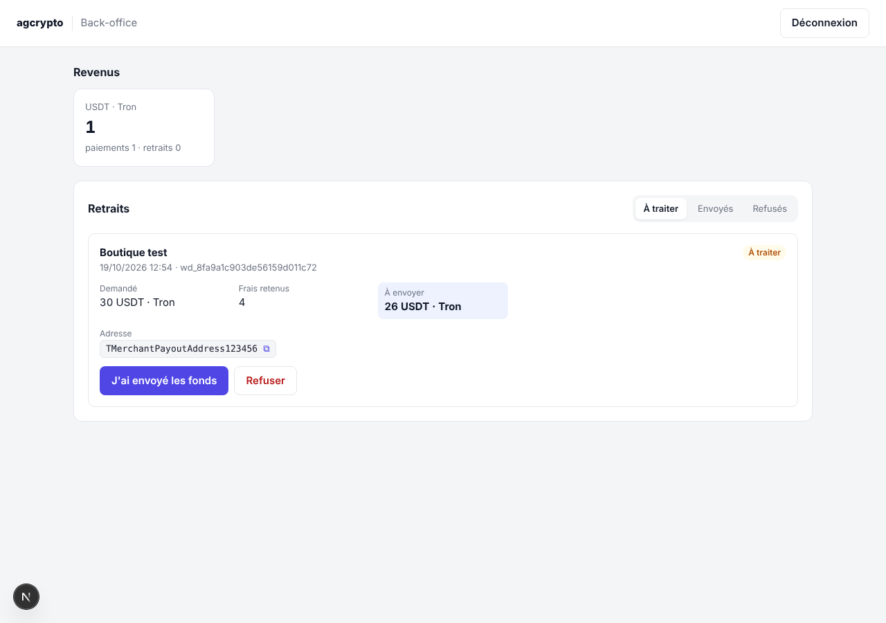
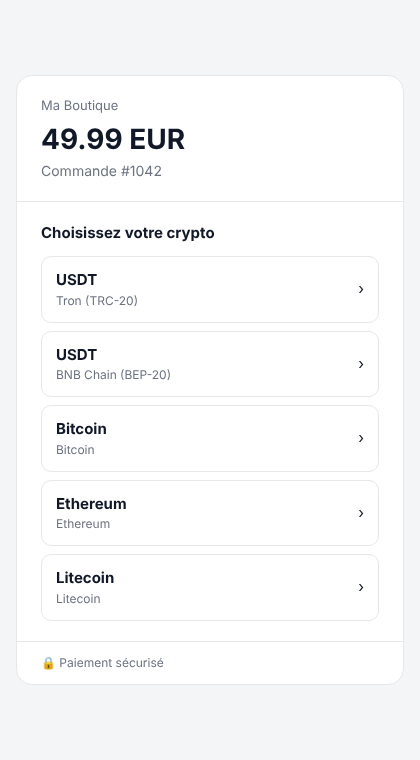
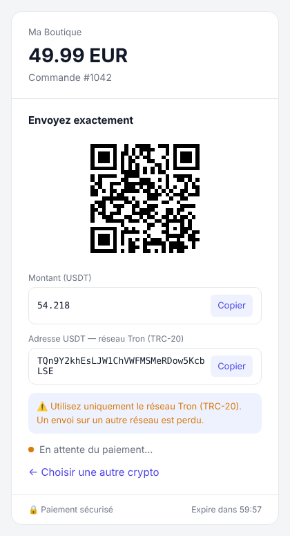

# agcrypto

Passerelle de paiement crypto multi-marchands. Les paiements sont encaissés via NOWPayments sur le compte
de la plateforme ; chaque marchand a un solde interne et demande des retraits, vérifiés et envoyés par l'équipe.

```
agcrypto/
├── backend/    API (Fastify + PostgreSQL) : paiements, soldes, retraits, page de paiement
├── frontend/   Interface (Next.js) : espace marchand + back-office
└── docker-compose.yml   PostgreSQL pour le développement
```

## Lancer en local

Prérequis : Node.js 22+ et Docker.

```bash
npm install          # installe backend + frontend
npm run setup        # génère backend/.env (jeton admin inclus) — rien à remplir pour tester
npm run db           # démarre PostgreSQL (port 55432) et crée les tables
npm run merchant:create -- "Boutique test"   # affiche la clé API du marchand
npm run dev          # backend sur :3000, frontend sur :3001
```

Ouvre **http://localhost:3001** :
- **Espace marchand** : se connecter avec la clé `agc_...` affichée par `merchant:create`.
- **Back-office** : se connecter avec `ADMIN_TOKEN` (dans `backend/.env`).

Par défaut le projet tourne en **mode démo** (`NOWPAYMENTS_ENV=demo`) : adresses fictives et bouton
« Simuler le paiement » sur la page de paiement, pour tester tout le parcours sans compte NOWPayments.

### Passer sur NOWPayments

Dans `backend/.env` :
```
NOWPAYMENTS_ENV=sandbox            # puis production
NOWPAYMENTS_API_KEY=...            # dashboard NOWPayments
NOWPAYMENTS_IPN_SECRET=...
PUBLIC_BASE_URL=https://...        # adresse publique du backend (NOWPayments y envoie les notifications)
```
En local, exposer le backend avec `cloudflared tunnel --url http://localhost:3000` et mettre l'URL obtenue
dans `PUBLIC_BASE_URL`.

## Captures

| Espace marchand | Back-office |
|---|---|
|  |  |

| Page de paiement : choix | Page de paiement : adresse |
|---|---|
|  |  |

## Fonctionnement

```
Marchand ──crée une facture──► backend ──► lien vers TA page de paiement (/pay/...)
Client choisit sa crypto ──► backend ──(serveur à serveur)──► NOWPayments ──► adresse + montant + QR
Client paie ──► NOWPayments ──notification signée──► backend
                                                     ├─ crédite le solde du marchand (− commission)
                                                     └─ webhook signé ──► site du marchand
Marchand demande un retrait ──► montant bloqué ──► ton équipe envoie le net ──► « J'ai envoyé les fonds »
```

## Frais (dans `backend/.env`)

| Variable | Défaut | Effet |
|---|---|---|
| `PAYMENT_FEE_PERCENT` | `1` | % retenu sur chaque paiement reçu (les frais NOWPayments sont déjà déduits par eux) |
| `WITHDRAWAL_FEE_PERCENT` | `10` | % retenu sur chaque retrait |
| `WITHDRAWAL_FIXED_FEES` | `{"usdttrc20":"1",...}` | Frais fixe par crypto ajouté au retrait (frais réseau) |

Exemple : retrait de 30 USDT → 3 (10 %) + 1 (fixe) = 4 de frais → **26 envoyés** au marchand.

## API marchand (`Authorization: Bearer agc_...`)

| Méthode | Route | Rôle |
|---|---|---|
| POST | `/v1/invoices` | Créer une facture `{amount, currency, order_id, description?, success_url?, cancel_url?}` → `checkout_url` |
| GET | `/v1/invoices` · `/v1/invoices/:id` | Liste / détail des factures |
| GET | `/v1/balance` | Soldes par crypto |
| GET | `/v1/withdrawals/quote?currency=&amount=` | Aperçu des frais de retrait |
| POST | `/v1/withdrawals` | Demander un retrait `{currency, amount, address, extra_id?}` |
| GET | `/v1/withdrawals` | Historique des retraits |

Webhooks : en-tête `x-agcrypto-signature: t=<timestamp>,v1=<hmac>` avec
`hmac = HMAC-SHA256(secret_webhook, "<timestamp>.<corps brut>")`.

## Back-office (`Authorization: Bearer <ADMIN_TOKEN>`)

| Méthode | Route | Rôle |
|---|---|---|
| GET | `/admin/withdrawals?status=requested\|completed\|rejected` | Retraits |
| POST | `/admin/withdrawals/:id/complete` | Après envoi : `{tx_hash}` |
| POST | `/admin/withdrawals/:id/reject` | Refuser et recréditer : `{reason}` |
| GET | `/admin/revenue` | Revenus par crypto |

## Sécurité et fiabilité

- Registre comptable : un paiement ne peut pas être crédité deux fois ; solde = somme des écritures.
- Montants en décimal exact (jamais de float).
- Notifications NOWPayments vérifiées (HMAC-SHA512) ; statuts qui ne reculent jamais.
- Retraits : montant bloqué dès la demande, deux demandes simultanées ne peuvent pas dépenser le même solde.
- Webhooks marchands avec relances jusqu'à 24 h.

## Tests

`npm test` : tests unitaires + parcours complet sur un vrai PostgreSQL en mémoire.

## Prochaines étapes

1. Inscription des marchands par email / mot de passe (aujourd'hui : clé API créée par l'admin).
2. Comptes nominatifs pour l'équipe back-office et journal d'audit des actions.
3. Gestion des marchands depuis le back-office (création, suspension).
